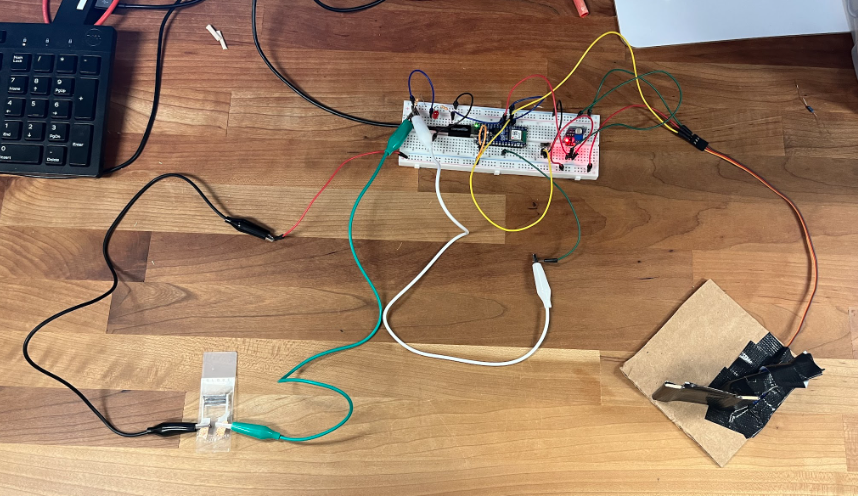

# FYRE-Assignments

Coursework and project materials for ENGR 095, "Sensing the World," at Lehigh University in Fall 2026.

## Programming Activities

Seven programming assignments and supporting data files from the Sensing the World module. The [Programming Activities README](Programming%20Activities/README.md) has the full activity list.

- [Program1.py](Programming%20Activities/Program1.py): Prints "Hello world."
- [Program2.py](Programming%20Activities/Program2.py): Prints the student's name.
- [Program3.py](Programming%20Activities/Program3.py): Prints the student's name using a string.
- [Program4.py](Programming%20Activities/Program4.py): Blinks an LED.
- [Program5.py](Programming%20Activities/Program5.py): Blinks an LED using a switch.
- [Program6.py](Programming%20Activities/Program6.py): Controls a servo arm using a switch.
- [Program7.py](Programming%20Activities/Program7.py): Reads ADC values, converts them to voltage, and records data in CSV files.

### Program 7 Trial Data

- [Trial1.csv](Programming%20Activities/Trial1.csv): Program 7 rain-drop sensor data with the sensor completely dry.
- [Trial2.csv](Programming%20Activities/Trial2.csv): Program 7 rain-drop sensor data with air blown onto the sensor.
- [Trial3.csv](Programming%20Activities/Trial3.csv): Program 7 data with half of the sensor surface wiped with a wet wipe.
- [Trial4.csv](Programming%20Activities/Trial4.csv): Program 7 data after the entire sensor surface was wiped down.
- [Trial5.csv](Programming%20Activities/Trial5.csv): Program 7 data with a wet wipe placed over the entire sensor surface.
- [ENGR 095 - 9_16.xlsx](Programming%20Activities/ENGR%20095%20-%209_16.xlsx): Supporting data for the September 16 activity.

## Project

The landslide-wall prototype was developed over three days, with each day's file recording edits to the previous version. The [Project README](Project%20/README.md) describes the progression and prototype.

- [Day1.py](Project%20/Day1.py): Initial prototype using a switch and photoresistor.
- [Day2.py](Project%20/Day2.py): Revises Day 1 by adding an air sensor and flashing the LED when triggered.
- [Day3.py](Project%20/Day3.py): Revises Day 2 to calculate air-sensor resistance for trigger detection.
- [Presentation.pdf](Project%20/Presentation.pdf): PDF of the project presentation slides.

The photo shows the prototype's breadboard control circuit and sensor wiring connected to the servo-mounted wall.

## Reflections

Three reflections cover different parts of the module. The [Reflections README](Reflections/README.md) summarizes each one.

- [Reflection_1.pdf](Reflections/Reflection_1.pdf): Reflection on the material science portion.
- [Reflection_2.pdf](Reflections/Reflection_2.pdf): Reflection on the computer engineering portion.
- [Reflection_3.pdf](Reflections/Reflection_3.pdf): Reflection on the final project.

